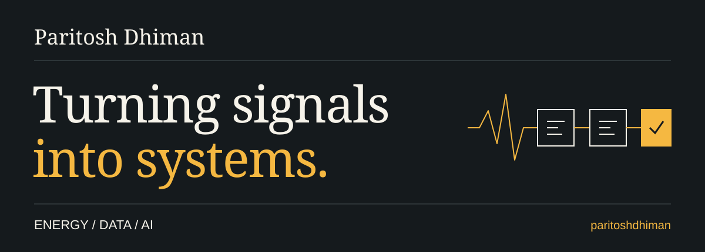

<picture>
  
</picture>

# Building where energy meets software.

I work with Python, operational data, and AI agents to turn complex energy problems into tools you can actually use.

**Energy analytics · Applied AI · Data tooling**

[Explore my repositories](https://github.com/paritoshdhiman?tab=repositories) · [Start with DELTA](https://github.com/paritoshdhiman/table12_hackathon)

---

## Featured: DELTA

**Dynamic Energy Load & Trading Analytics**

An energy trading dashboard that brings market analysis, plant dispatch, scenario simulation, and compliance into one workspace. A multi-agent AI system adds specialist perspectives on markets, dispatch, compliance, and risk.

Built for an AWS hackathon with **Python · Streamlit · Amazon Bedrock · AgentCore**.

[Explore the project →](https://github.com/paritoshdhiman/table12_hackathon#readme)

## More from the workbench

| Project | What you'll find |
| :--- | :--- |
| [**Streamer Screamer**](https://github.com/paritoshdhiman/streamer_screamer) | A Streamlit interface for streaming tabular data to TCP clients with Python's async networking. |
| [**Dispatch Export Reader**](https://github.com/paritoshdhiman/dispatch_export_reader) | Tools to normalize, compare, and explore dispatch exports. |
| [**ProppantIQ / Fracsim**](https://github.com/paritoshdhiman/fracsim) | A Streamlit simulation and analysis tool for proppant concentration, pumped totals, and operational signals. |

## Tools I reach for

**Python** / **pandas** / **NumPy** / **Streamlit** / **Plotly**  
**AWS Bedrock** / **AgentCore** / **asyncio** / **APIs**

---

**From raw signals to useful decisions.**
