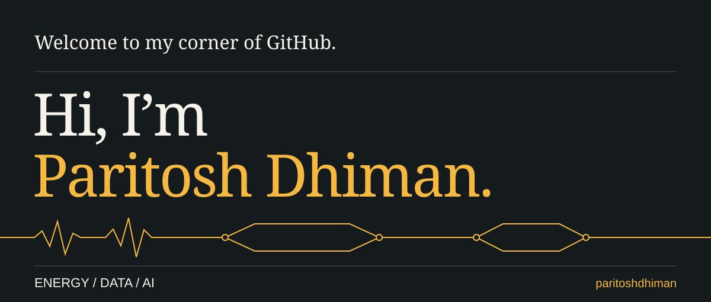
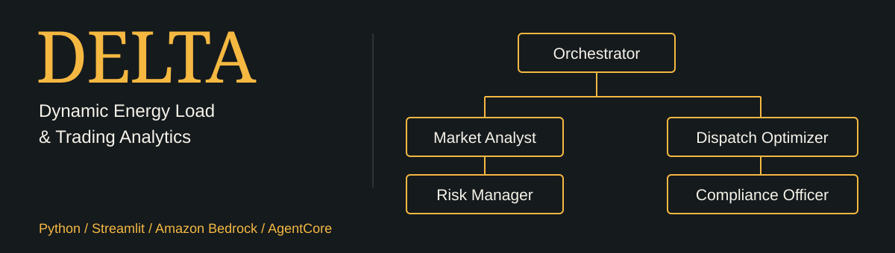

<picture>
  
</picture>

# A little energy. A lot of Python.

I’m Paritosh. I build with Python, operational data, and AI agents at the intersection of energy and software.

This is my workbench: streaming data, exploring signals, simulating operations, and turning complex problems into tools you can actually use.

**Energy analytics · Applied AI · Data tooling**

[Take a look around](https://github.com/paritoshdhiman?tab=repositories) · [Explore DELTA](https://github.com/paritoshdhiman/table12_hackathon#readme)

---

## A few things I’ve built

### DELTA

**Dynamic Energy Load & Trading Analytics** brings market analysis, plant dispatch, scenario simulation, and compliance into one workspace, with specialist AI agents for markets, dispatch, compliance, and risk.

Built for an AWS hackathon with **Python · Streamlit · Amazon Bedrock · AgentCore**.

[Step inside DELTA →](https://github.com/paritoshdhiman/table12_hackathon#readme)

### More experiments from the workbench

- [**Streamer Screamer**](https://github.com/paritoshdhiman/streamer_screamer) — tabular data on the move, with Streamlit, TCP clients, and Python’s async networking.
- [**Dispatch Export Reader**](https://github.com/paritoshdhiman/dispatch_export_reader) — normalize, compare, and explore dispatch exports.
- [**ProppantIQ / Fracsim**](https://github.com/paritoshdhiman/fracsim) — simulate proppant concentration and explore pumped totals and operational signals.

## My usual ingredients

**Python** / **pandas** / **NumPy** / **Streamlit** / **Plotly**  
**AWS Bedrock** / **AgentCore** / **asyncio** / **APIs**

---

Thanks for stopping by. [Find something to explore →](https://github.com/paritoshdhiman?tab=repositories)
